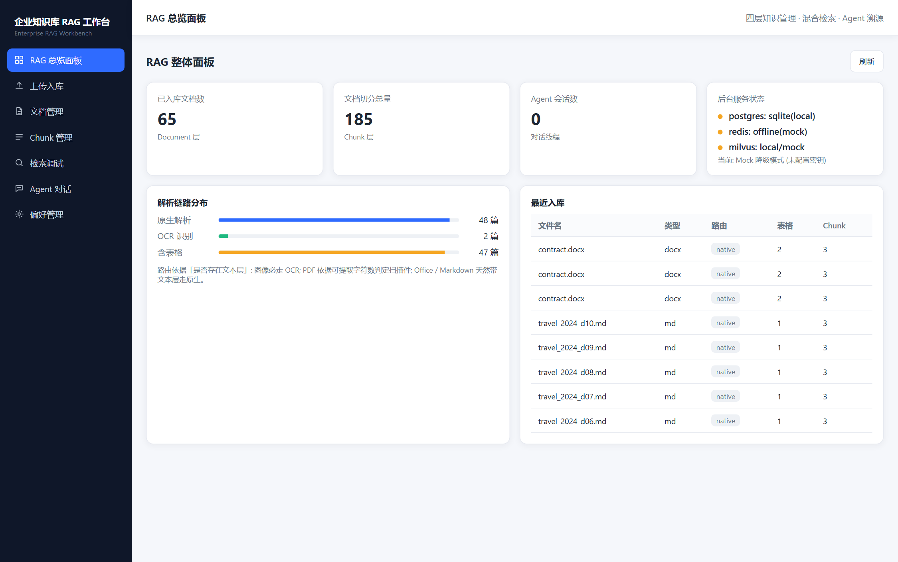
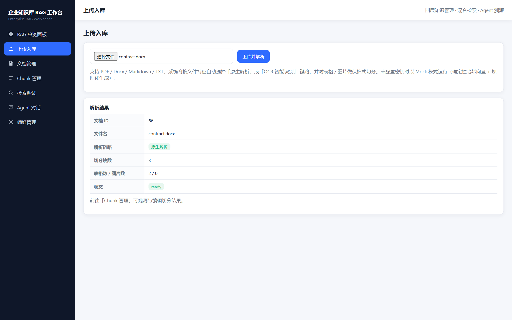
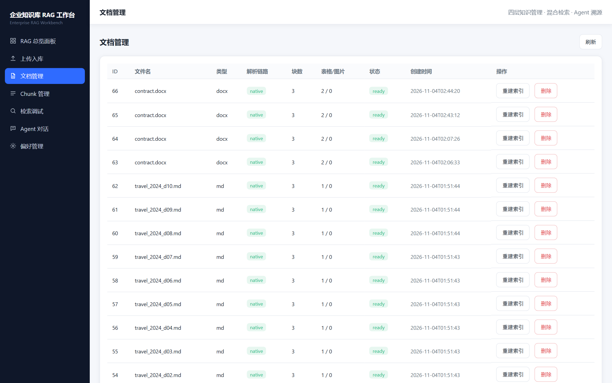
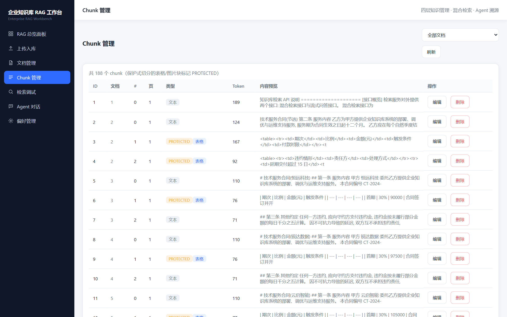
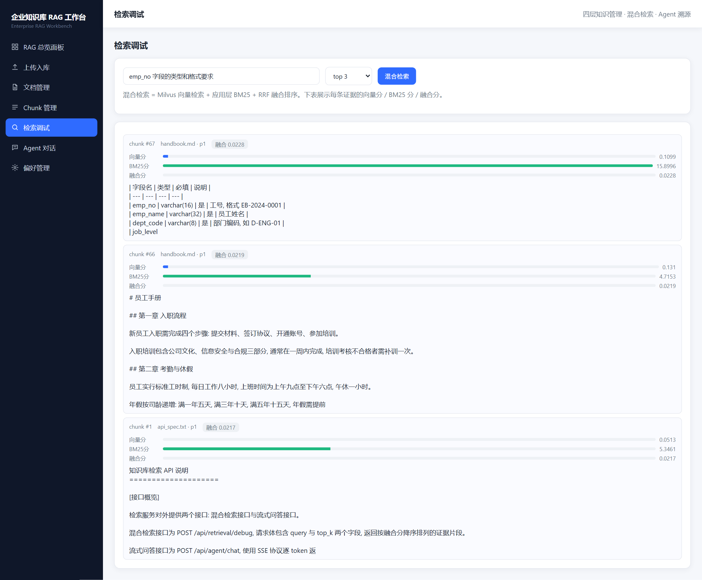
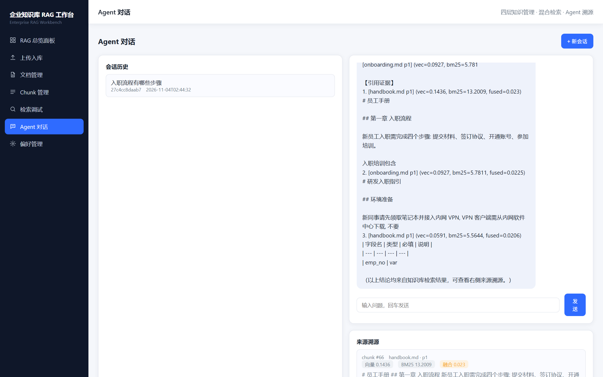
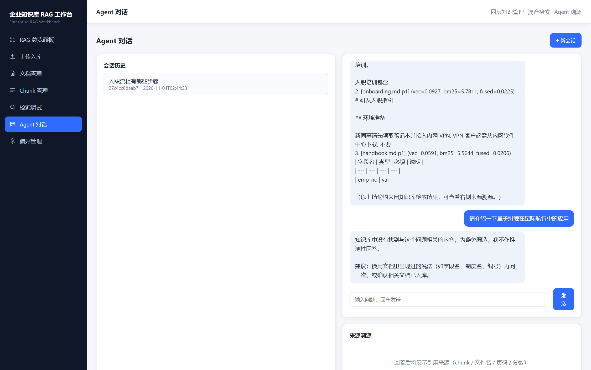
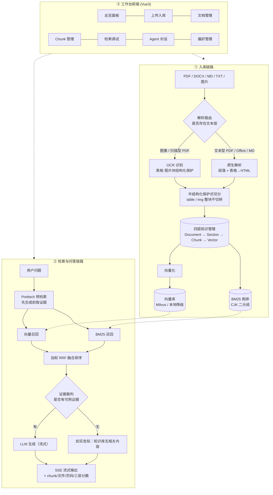

# 企业知识库 RAG Agent 工作台

> 从**文档入库**到**带溯源的流式问答**的全链路实现：四层知识管理 + 双链路解析 + 半结构化保护式切分 + 混合检索 + Agent 对话。  
> 无密钥也能跑（自动 Mock 降级），配好密钥即切换真实 PG / Milvus / DashScope。

     

---

## 目录

- [为什么做这个项目](#为什么做这个项目)
- [实测效果](#实测效果)
- [界面演示](#界面演示)
- [系统架构](#系统架构)
- [关键设计](#关键设计)
- [快速启动](#快速启动)
- [测评：怎么做、怎么复现](#测评怎么做怎么复现)
- [目录结构](#目录结构)
- [API 一览](#api-一览)
- [已知限制与后续计划](#已知限制与后续计划)

---

## 为什么做这个项目

企业文档问答有四类反复出现的硬问题，这个项目逐条对应解决：

| 痛点            | 现实表现                                    | 本项目的做法                                             |
| ------------- | --------------------------------------- | -------------------------------------------------- |
| **格式杂**       | PDF / Word / Markdown / 扫描件混在一起，解析器各写一套 | 统一 `ParsedBlock` 中间表示，原生解析与 OCR 两条链路输出同构结果         |
| **表格/扫描件难解析** | 表格被按字数硬切，切完只剩半张表，问答直接答错                 | 半结构化保护式切分：`<table>` / `` 整块不切碎，标记 `protected` |
| **关键词命中不稳**   | 纯向量检索对字段名、编号、配置项这类精确词召回差                | 应用层 BM25（CJK 二元组分词）与向量路做加权 RRF 融合                  |
| **回答没有依据**    | 模型自由发挥，用户无法核对，也不敢采信                     | Prefetch 预检索先取证据再生成 + 证据裁判：证据不足直接说"没有"，回答同步回传 chunk / 文件 / 页码 / 三层分数 |

---

## 实测效果

全部数字由 [`eval/run_eval.py`](eval/run_eval.py) 实测产出，可一条命令重跑复现，完整报告见 **[eval/report.md](eval/report.md)**。

| 指标                    | 结果                                | 测量口径                                                              |
| --------------------- | --------------------------------- | ----------------------------------------------------------------- |
| **复杂文档入库成功率**         | **77.8% → 100%**（7/9 → 9/9）       | 手工基准文档中 9 篇含表格/扫描件的复杂文档；"成功"= 路由正确 + 表格完整落在同一 chunk + 字符覆盖率 ≥ 98% |
| **混合检索 Hit@5（对比纯向量）** | **63.7% → 80.2%，+25.9%**          | 62 篇文档 / 176 chunk / 91 题；Top-5 命中唯一关键串即算命中                       |
| **混合检索 vs BM25 单路**   | 80.2% vs 81.3%（差 **1 题**）         | 如实记录：见下方"口径与局限"，Mock 嵌入下未超越单路                                     |
| **无关问题拒答率**           | **10/10 全部拒答**（不作答、不编造）           | 10 道与语料完全无关的问题；同时 91 道范围内问题放行 94.5%，未被误拒                          |
| **首 token 延迟**        | **≈40 ms**（P50 ≈45 ms，P95 ≈52 ms） | 20 次采样，含 Prefetch 预检索与 SSE 首帧；Mock 生成，不含真实 LLM 推理                 |
| 来源可溯源率                | 100%                              | 每条回答回传 `chunk_id / 文件名 / 页码 / 向量分 / BM25 分 / 融合分`                 |

### 口径与局限（重要，别跳过）

- **运行在 Mock 模式**：不配置任何密钥时，嵌入是确定性哈希、生成是规则模板，而**解析 / 切分 / BM25 / RRF 全部是真实生产代码**。所以"入库成功率"结论可靠；"检索"部分的绝对值和向量路表现**不代表真实嵌入模型**。
- **不宣称"混合检索优于单路 BM25"**：实测中"仅向量命中"只有 1 题、而"仅 BM25 命中"有 17 题 —— 哈希嵌入本质仍是词面匹配，与 BM25 同质，融合只能贴近强的那一路。接入 DashScope `text-embedding-v3` 后把 `RRF_WEIGHT_VECTOR` 调回 `1.0` 重跑，才具备评估"混合是否超越单路"的前提。
- **OCR 是 Mock 实现**：验证的是"图片→OCR 路由正确"与"OCR 表格块被保护"，**不是识别准确率**。装 `rapidocr-onnxruntime` 并设 `OCR_ENGINE=rapid` 后可测真实识别率。
- **证据裁判是词面判定**：同义改写会被误判成"知识库没有"（问"薪酬"，文档写"工资"）。这是为了不编造而选的保守一侧，接入真实语义嵌入后应把向量相似度也作为一路信号并重测阈值（`EVIDENCE_MIN_TERMS` / `EVIDENCE_GATE_TOP_N` 可调）。

---

## 界面演示

> 以下均为真实页面 + 真实数据的截图，由 [`scripts/shots.mjs`](scripts/shots.mjs) 自动抓取，可用同一脚本重新生成。

### RAG 总览面板

入库文档数 / 切分总量 / 会话数 / 服务状态，以及解析链路分布与最近入库列表。



### 上传入库（双链路解析结果）

上传 Word 后自动判定走原生解析，返回切分块数、表格数、状态。



### 文档管理

按文档维度查看类型 / 路由链路 / 表格与图片数 / chunk 数，支持物理删除与索引重建。



### Chunk 管理（保护式切分可见）

表格块标记 **PROTECTED**，与普通文本块区分展示，可编辑内容（自动重嵌入）、可删除。



### 检索调试（三层分数可视化）

Top-1 直接命中"员工档案字段说明"表格块 —— 这正是被保护下来的结构；每条证据展示向量分 / BM25 分 / 融合分。



### Agent 对话（流式 + 溯源）

SSE 逐 token 输出，回答附带 `[引用段落]` 与分条溯源卡片。



### 证据裁判（该拒答就拒答）

同一个对话框里问一个知识库完全无关的问题，回答是"知识库中没有找到相关内容"，右侧来源为空 —— 而不是拿检索到的最不相关片段硬凑一段话。



---

## 系统架构



**技术栈**：Python 3.11+ / FastAPI / SQLAlchemy 2 / PostgreSQL / Milvus / Redis / BM25（应用层） / RRF / PaddleOCR（可选 RapidOCR） / Vue3 + TypeScript + Vite + Pinia

---

## 关键设计

### 1. 四层解耦知识管理

`Document → Section → Chunk → Vector` 逐层分离：文档管元信息与解析特征，Section 管结构，Chunk 管检索粒度与保护标记，Vector 管嵌入副本（含模型名 / 维度 / 存储后端）。  
好处是**改切分策略不动向量层、换向量库不动业务表**，删除文档靠 ORM 级联一次清干净。

### 2. 双链路解析 + 可解释路由

路由只看一件事：**这个文件到底有没有文本层**。

| 文件类型              | 决策                                   | 理由                |
| ----------------- | ------------------------------------ | ----------------- |
| png / jpg / tiff… | 必走 OCR                               | 没有文本层             |
| docx / md / txt   | 必走原生                                 | 按定义带文本层           |
| pdf               | 看可提取字符数（全文 < 50 字符或每页 < 40 字符 → OCR） | 唯一可能出现"只有图像"的原生格式 |

> 早期版本用"文本密度 < 0.35 就走 OCR"一条阈值统管全部格式，而密度公式对每张表扣 500 字符 —— 结果是**表格越多的正常文档越容易被判成扫描件**。测评集复现了这个问题（6 篇结构化文档里 5 篇被误判），遂改为上表的决策方式，修复后语料路由 100% 正确。详见 [eval/report.md](eval/report.md)。

### 3. 半结构化保护式切分

文本按 `chunk_size` 滑窗切（带 overlap），但遇到 `table` / `image` 块时**先 flush 文本缓冲，再把整块单独成 chunk** 并标记 `protected=True`。  
这样"半张表"的问题从源头消失 —— 测评里入库成功率的提升全部来自这一项（两种策略的字符覆盖率都 ≈1.0，差别只在**结构有没有被切断**）。

### 4. 混合检索：向量 + BM25 + 加权 RRF

- **BM25 用 CJK 二元组分词**：中文没有空格，若把整串汉字当一个 token，查询"工号的格式要求"与文档"工号, 格式 EB-2024-0001"永远匹配不上 —— 实测这一步会把 BM25 命中率从 96% 拉到 20% 以下。
- **RRF 加权融合**：`score = Σ w_i / (k + rank_i)`。`k` 与候选列表长度同量级（本库取 10，而非面向万级语料的通用值 60）；两路质量不均衡时用权重表达"更信谁"，避免弱路稀释强路。
- **Prefetch 预检索**：生成之前先取证据并做裁判，无可用证据时如实说"知识库中没有"，而不是让模型自由发挥。

### 5. 证据裁判：先判断"该不该答"

检索**永远**会返回 Top-K —— 库里没有相关内容时，加权 RRF 照样会排出一个"最不相关里最像的"片段。若直接把它塞进 prompt，模型就会顺着这些无关片段编出一个看着有依据的答案；这比直接报错危险得多，因为用户无法核对，却敢采信。

所以生成之前有一道闸门（`backend/app/retrieval/gate.py`）：把问题切成内容词，看它们在**前 3 条证据**里命中了几个，少于 2 个就拒答并说明"知识库中没有"。

- 用**命中词数**而不是分数阈值：RRF 分是名次派生量，没有绝对标度；Mock 模式下向量分更是哈希投影。而"命中了几个实词"可解释、可复现、与嵌入模型无关。
- 先丢掉疑问词（"怎么""什么""如何"）—— 否则"Python 怎么处理多线程"会靠"怎么""处理"蹭进无关文档。
- 只统计语料词表里存在的词：语料里从没出现过的词（"量子""纠缠"）不可能被任何证据命中，计入分母只会让所有问题都显得很差。

代价是保守：词面不同的同义说法（问"薪酬"、文档写"工资"）会被判为无证据。对一个"不许编"的企业知识库来说，漏答比编造便宜。实测 10 道无关问题全部拒答，91 道范围内问题放行 94.5%（被拦的 5 道本身也是检索未命中的题）。

---

## 快速启动

### 方式 A：零依赖启动（Mock 模式，推荐先跑这个）

不需要 Docker、不需要任何云密钥：SQLite 替代 PG、本地 JSONL 向量库替代 Milvus、内存字典替代 Redis、确定性哈希嵌入替代 DashScope。

```bash
# 1) 后端
cd backend
python -m venv venv
venv/Scripts/activate            # Windows；macOS/Linux: source venv/bin/activate
pip install -r requirements.txt
cp ../.env.example .env          # 可留空 = Mock 模式
python -m uvicorn app.main:app --reload --port 8000

# 2) 打开 http://127.0.0.1:8000
#    后端已托管前端构建产物，单端口即可使用；开发前端时另开终端跑 npm run dev
```

前端开发模式（可选，带热更新）：

```bash
cd frontend
npm install
npm run dev        # http://localhost:5173，已配置 /api → :8000 代理
```

一键脚本：`scripts/start.ps1`（Windows）/ `scripts/start.sh`（macOS·Linux）。

### 方式 B：真实服务（PostgreSQL + Milvus + Redis + 真实嵌入/LLM）

```bash
docker compose up -d                      # Milvus + etcd + MinIO + PG + Redis (+ MySQL/Neo4j)
cd backend && pip install -r requirements.txt -r requirements-optional.txt
cp ../.env.example .env                   # 填入 DASHSCOPE_API_KEY / LLM_API_KEY
python -m uvicorn app.main:app --port 8000
```

`.env` 关键项（**密钥只走环境变量，绝不入库**）：

| 变量                                                | 说明                                   |
| ------------------------------------------------- | ------------------------------------ |
| `FORCE_MOCK`                                      | `true` 强制 Mock；`false` 且密钥齐全时自动走真实服务 |
| `DATABASE_URL` / `REDIS_URL` / `MILVUS_HOST`      | 基础设施连接串                              |
| `DASHSCOPE_API_KEY` / `EMBEDDING_MODEL`           | 嵌入服务（默认 `text-embedding-v3`）         |
| `LLM_API_KEY` / `LLM_MODEL` / `LLM_BASE_URL`      | 生成模型（OpenAI 兼容接口）                    |
| `OCR_ENGINE`                                      | `mock` / `rapid` / `paddle`          |
| `RRF_K` / `RRF_WEIGHT_VECTOR` / `RRF_WEIGHT_BM25` | 融合参数，接入真实嵌入后建议向量权重调回 1.0             |
| `EVIDENCE_MIN_TERMS` / `EVIDENCE_GATE_TOP_N`      | 证据裁判阈值：问题内容词至少要在前 N 条证据里命中几个才作答 |

> 缺任一密钥即自动降级为 Mock，**项目永远能启动**，不会因为没配密钥而白屏。

---

## 测评：怎么做、怎么复现

测评集与脚本都在 [`eval/`](eval/)，语料由脚本按固定规则生成，**结果可复现**。

```bash
cd enterprise-rag-workbench
backend/venv/Scripts/pip install -r eval/requirements-eval.txt
backend/venv/Scripts/python.exe eval/gen_corpus.py    # 生成 62 篇真实文件(md/txt/docx/pdf/png) + 91 条 QA
backend/venv/Scripts/python.exe eval/run_eval.py      # 产出 eval/report.md
```

三点设计保证评测不注水：

1. **真文件**：语料是真的 docx、真的 PDF（reportlab + 中文字体）、真的无文本层位图，只有真文件才会触发不同解析分支。
2. **QA 关键串强校验**：每题带唯一 `key`，`gen_corpus.py` 会断言它确实出现在对应文档里，杜绝"问题与语料漂移"导致指标虚高。
3. **规模化干扰项**：除 12 篇手工基准文档外，另按固定规则生成 50 篇版式几乎相同、只有部门/年度/金额不同的制度文件 —— 这才是真实企业库里"标题词命中不稳"的场景。

指标定义（全部写在脚本里，不是口头承诺）：

- **入库成功率**：路由正确 ∧ 每张表格完整落在同一 chunk ∧ 字符覆盖率 ≥ 98%（6 字符 shingle 覆盖率，按内容块计算以免把合法的 chunk 分界算成丢字）。
- **Hit@5 / MRR@10**：Top-5 中任一片段包含该题唯一关键串即命中（单一正解，Hit@k 等价 Recall@k）。
- **拒答率**：10 道与语料完全无关的问题（量子纠缠、红烧肉、天气……）走完整对话链路，统计有多少被证据裁判挡住；同时统计 91 道正常问题的放行率，防止"一律拒答"这种作弊式达标。
- **首 token**：对运行中服务发 N 次 SSE 请求，测"发出请求 → 收到第一个 token 事件"。

测评过程中发现并修复的真实缺陷（都在上面"关键设计"里有对应说明）：路由层把表格密集文档误判为扫描件、中文 BM25 分词失效、切分器超长段落导致内容重复入库、Mock 嵌入与 BM25 分词口径不一致。

---

## 目录结构

```
enterprise-rag-workbench/
├── backend/
│   ├── app/
│   │   ├── api/            # 7 个路由: upload / documents / chunks / retrieval / agent / preferences / overview
│   │   ├── chunking/       # 半结构化保护式切分
│   │   ├── parsers/        # 双链路解析: native / ocr / router(启发式路由)
│   │   ├── retrieval/      # BM25(CJK 二元组) / RRF(加权融合) / hybrid(Prefetch 编排) / gate(证据裁判)
│   │   ├── agent/          # 工具调用 / 证据裁判 / SSE 流式 / 会话线程
│   │   ├── vector/         # 嵌入服务(真实 + Mock) / 向量库(Milvus + 本地降级)
│   │   ├── db/             # SQLAlchemy 模型(四层) / PG(SQLite 兜底) / Redis(内存兜底)
│   │   ├── services/       # 文档流水线 / chunk / 偏好 / 统计
│   │   └── config.py       # 唯一配置入口 + Mock 降级判定
│   └── requirements.txt    # 最小依赖(保证 Mock 可直接启动)
├── frontend/src/           # Vue3 + TS: 7 个页面 + SSE 请求封装
├── eval/                   # 测评: 语料生成 / QA 集 / 指标脚本 / 报告
├── docs/screenshots/       # 真实页面截图
├── scripts/                # 一键启动 + 截图生成
├── docker-compose.yml      # Milvus + etcd + MinIO + PG + Redis (+ MySQL/Neo4j)
└── .env.example
```

---

## API 一览

| 方法             | 路径                            | 说明                                                     |
| -------------- | ----------------------------- | ------------------------------------------------------ |
| POST           | `/api/upload`                 | 上传文档，走完整入库流水线，返回路由/切块/表格统计                             |
| GET            | `/api/documents`              | 文档分页列表                                                 |
| DELETE         | `/api/documents/{id}`         | 文档物理删除（级联 chunk / 向量 / 索引）                             |
| POST           | `/api/documents/{id}/rebuild` | 重建索引                                                   |
| GET            | `/api/chunks`                 | Chunk 分页列表（含 `protected` 标记）                           |
| PUT            | `/api/chunks/{id}`            | 编辑 chunk 内容并重新嵌入 + 重索引                                 |
| DELETE         | `/api/chunks/{id}`            | 软删除 chunk 并同步移除向量与索引                                   |
| POST           | `/api/retrieval/debug`        | 混合检索调试，返回三层分数                                          |
| POST           | `/api/agent/chat`             | 多轮对话，**SSE 流式**（`meta` / `token` / `sources` / `done`） |
| GET·POST       | `/api/agent/threads`          | 会话线程列表 / 新建                                            |
| GET·PUT·DELETE | `/api/preferences`            | 偏好（注入 Agent 的记忆）                                       |
| GET            | `/api/overview`               | 看板总览 + 服务健康状态                                          |

交互式接口文档：启动后访问 `/docs`。

---

## 已知限制与后续计划

**限制**

- OCR 为 Mock 实现，未验证真实识别准确率；真实引擎需自行安装并切换 `OCR_ENGINE`。
- Mock 模式下的"向量检索"是哈希投影，不代表语义模型效果；所有检索绝对值都需在真实嵌入下重测。
- 会话历史切换目前是占位交互（弹出 thread_id），未做历史消息回放。
- 单机单进程：`LocalVectorStore` 与内存 BM25 不支持多副本共享（生产应全程用 Milvus + 独立检索服务）。

**计划**

- 真实 OCR 接入 + 扫描件识别率测评
- BM25 替换为独立服务（Elasticsearch / Whoosh）以支持多副本
- 会话历史回放与多轮上下文压缩
- 增加英文 / 中英混排语料的检索测评

---

## License

[MIT](LICENSE)
